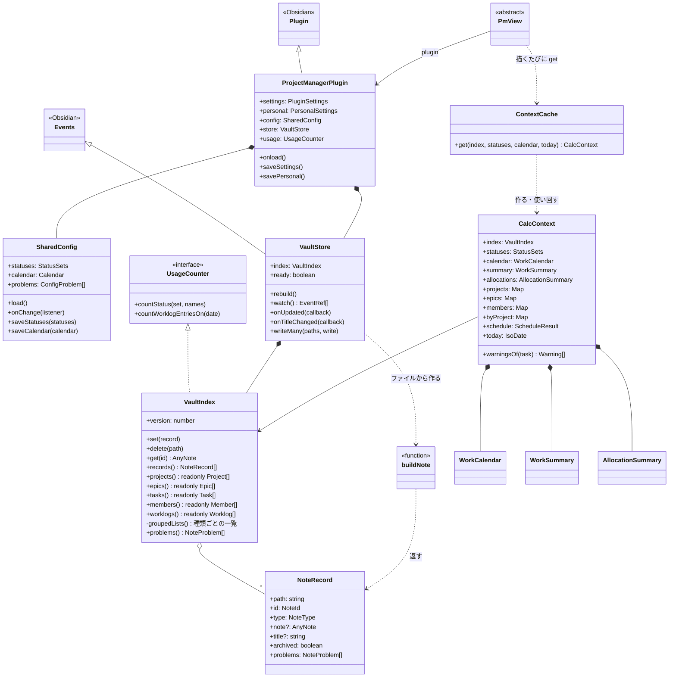
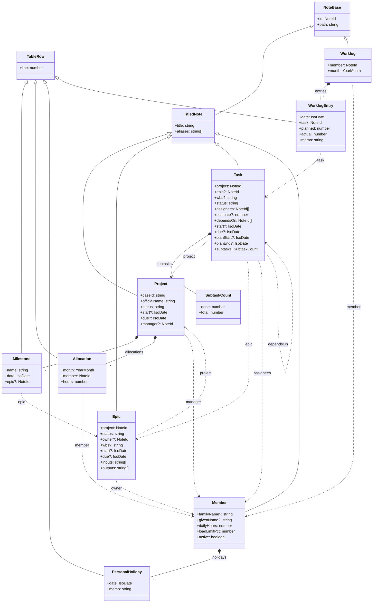
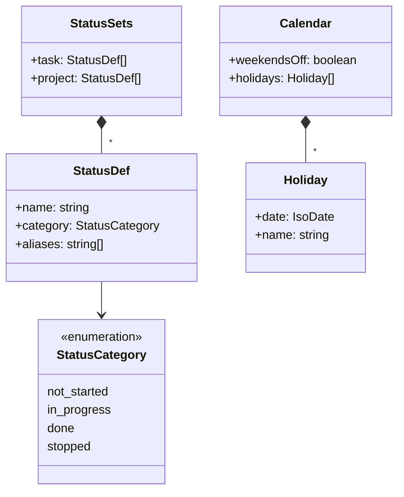
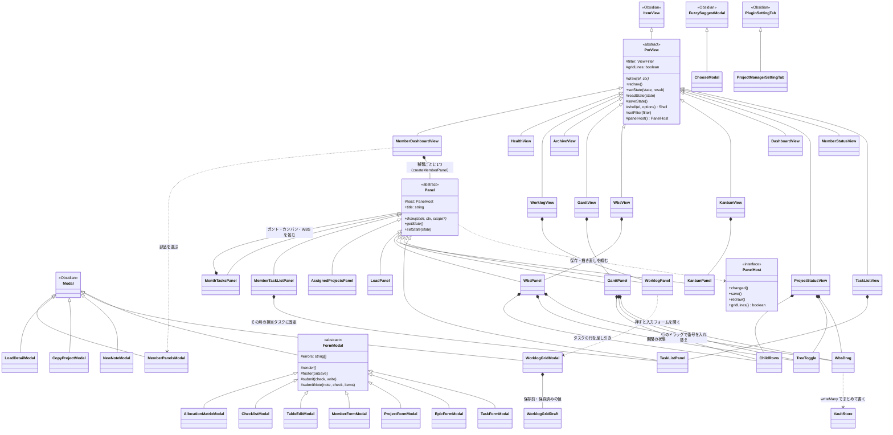
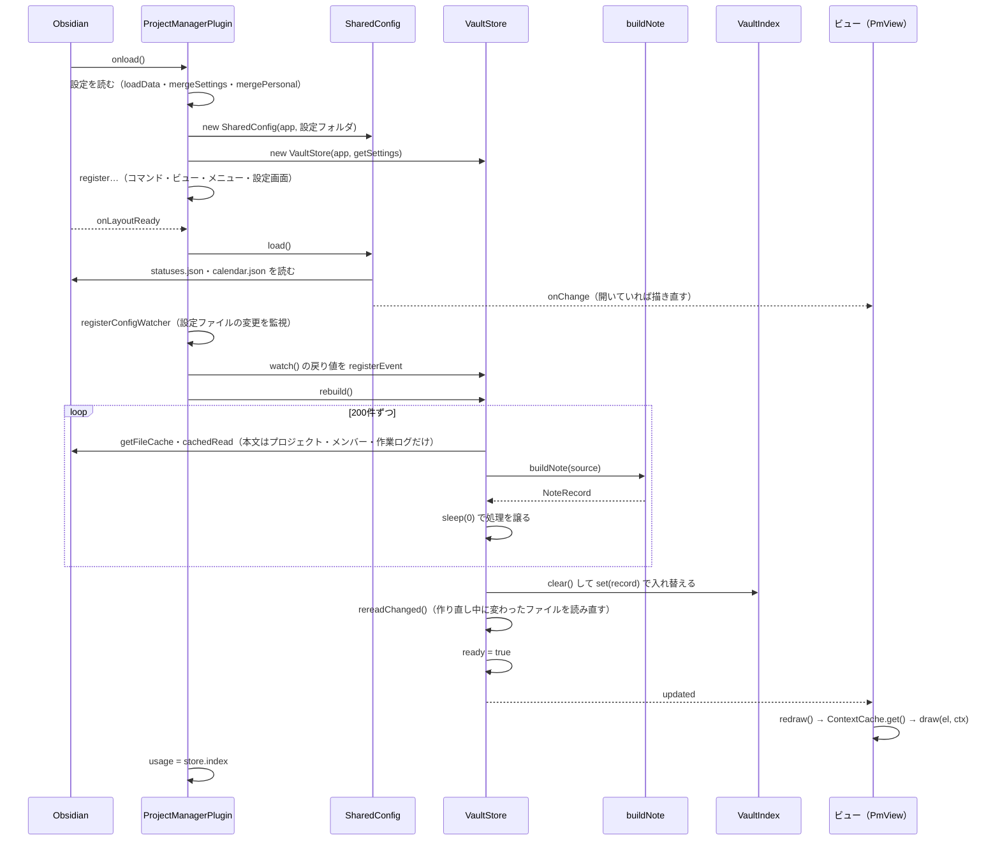
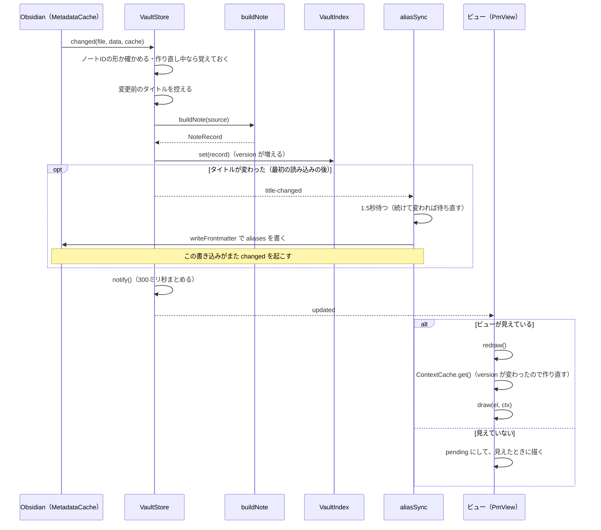
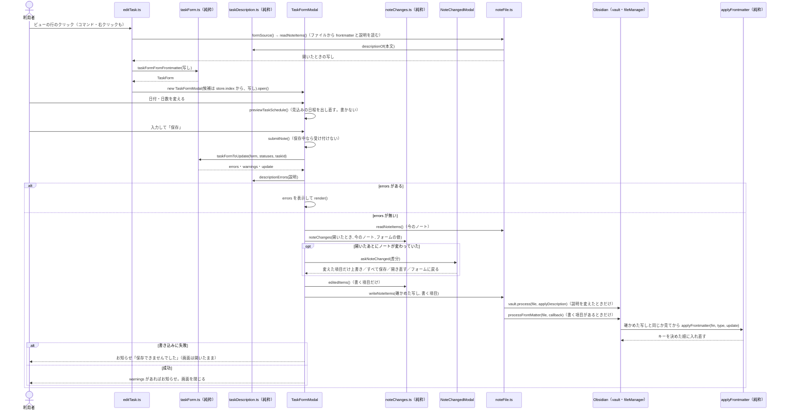

# 図

今の作りを、クラス図とシーケンス図で示す。

- 図は Mermaid で書く。Obsidian・VS Code のプレビューで図として表示される
- 理由や細かい決まりは [DESIGN.md](DESIGN.md) に書き、ここでは節番号で参照する
- 図に出すのは主なクラス・関数だけ。すべての項目は載せない
- クラスや処理の流れを変えたら、この文書も直す。**節番号は変えない**

---

## 1. クラス図

### 1.1 全体（プラグインと主なクラス）

- `ProjectManagerPlugin` が共有設定（`SharedConfig`）と索引の管理（`VaultStore`）を1つずつ持つ
- ビューは描くたびに `ContextCache` から計算用のデータ（`CalcContext`）を受け取る（設計書 11章）
- 「Obsidian」の印は Obsidian API のクラス

### 1.2 ノートの型（`model/`）

- 実線のひし形は、ノートの本文の表の行を持つことを表す（7章）
- 点線の矢印は、ID（`[[接頭辞-UUID]]`）での参照を表す。矢印の文字はプロパティ名
- 各ノートの `type` は `project`・`epic`・`task`・`user`・`worklog`

### 1.3 共有設定の型（`model/`、設計書 5章）

### 1.4 画面のクラス（`views/`・`ui/`）

- ビューはすべて `PmView` を継ぐ（設計書 9.1）
  - 中身は `draw(el, ctx)` だけを書く。描き直しのきっかけと枠（シェル）は `PmView` が受け持つ
- 保存して閉じる入力画面は `FormModal` を継ぐ（設計書 4.5, 4.6）
  - 中身は `render()` を書き、保存は `submit(check, write)` に任せる
- タスク一覧・作業ログ・ガント・カンバン・WBS の中身は部品（`Panel`）。ビューは部品を1つ載せる（設計書 9.12）
  - メンバーダッシュボードは、同じ部品を種類ごとに1つずつ作って並べる（設計書 9.11）
  - 部品は保存・描き直しを置き場所（`PanelHost`）に頼む
- WBS・ガントの部品とプロジェクト状況は `WbsDrag` を1つずつ持ち、行のドラッグで番号を書き換える（設計書 9.7）
- 同じ3つは `TreeToggle`（開閉の状態）と `ChildRows`（タスクの行の足し引き）も1つずつ持つ（設計書 9.7）

---

## 2. シーケンス図

### 2.1 起動から索引の作成まで（設計書 1.3, 3.2）

- `onload` では登録だけをし、重い読み込みは `onLayoutReady` の後に行う
- 索引ができるまで、開いているビューは「読み込み中…」を出す

### 2.2 ノートの変更と差分更新（設計書 3.3, 4.2, 9.1）

- 利用者の操作でも、プラグインの書き込みでも、同じ流れで画面に届く
- 名前の変更は vault の `rename`、削除は vault の `delete` で受ける（この図では省く）

### 2.3 入力補助フォームでの書き込み（設計書 4.1, 4.5, 4.6, 4.11, 4.15）

- タスクの例。エピック・プロジェクト・メンバーも同じ流れ（本文の説明はタスクだけ）
- 画面の更新は書き込みの後、2.2 の流れで起こる

