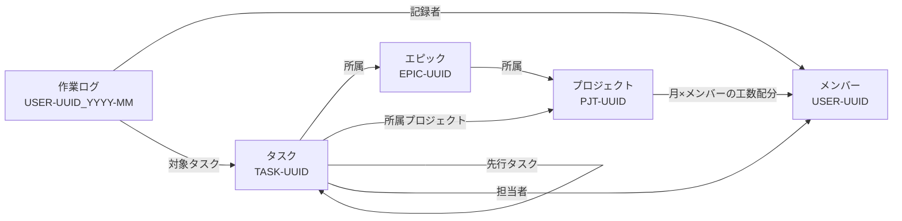

# Obsidian プロジェクト管理プラグイン 要件定義書 v1.0

最終更新：2026-11-04

何を作るか（仕様）の正本。作りと理由は [DESIGN.md](DESIGN.md)、変更の経緯は [HISTORY.md](HISTORY.md)。

---

## 1. 目的・背景

複数プロジェクトにまたがるメンバーの負荷と進捗を、Obsidian 上で横断的に可視化する。

- メンバーは複数プロジェクトに同時にアサインされる
  - **メンバー単位・全プロジェクト横断**で負荷を把握したい
- 細かいタスクの進捗まで追えるようにしたい
- 1件1Markdownファイルでデータベースを作り、同じデータをビューの切り替えで多面的に見る
- 想定業務は汎用。主に CG 画像制作、システム開発、研究・検証系の投資案件

---

## 2. 利用者と運用環境

| 項目 | 内容 |
| --- | --- |
| 利用人数 | 約50人 |
| 編集者 | ほぼ全員（各自のタスク・作業ログを編集） |
| 閲覧者 | 上司など。SVN を使わず HTMLレポートで閲覧 |
| 同時進行プロジェクト | 約10件 |
| 動作環境 | Obsidian デスクトップ版（Windows）。モバイルは対象外 |
| POC環境 | ファイル共有サーバー上に Vault を置く |
| 本番環境 | 社内サーバーの SVN で Vault を管理 |
| SVN同期 | 各自が手動で更新・コミット（TortoiseSVN 等）。問題があればプラグインへの組み込みを検討 |
| 利用者のスキル | エンジニア以外も使う |

### 運用ルール

- アーカイブフォルダへの移動は SVN の「移動」で行う（エクスプローラーで動かすと履歴が途切れる）
- POC 期間中は、同じタスクを複数人で同時に編集しない
- 個人の画面状態（`.obsidian/workspace.json` 等）は `svn:ignore` で除く
- プラグインはビルド結果（`main.js`・`manifest.json`・`styles.css`）を Vault に置いて配る
- ソースコードは Vault と別に管理する

---

## 3. データモデル

### 3.1 基本方針

- すべての情報を「1件1Markdownファイル」で持つ
- ノート同士は「種類の接頭辞＋UUID」のファイル名（＝ID）で参照する
- 所属・タイトルはプロパティで持ち、ファイル名やフォルダに意味を持たせない
- ユーザーが ID を意識する必要はない

### 3.2 ID規則

- ファイル名 = `接頭辞-UUID`。UUID は **v7**（先頭が作成日時で、並べると作成順になる）
- 接頭辞：`PJT`（プロジェクト）、`EPIC`（エピック）、`TASK`（タスク）、`USER`（メンバー）
- 作業ログだけ `USER-UUID_YYYY-MM`
- タイトル（メンバーは氏名）はプロパティ `title` に持ち、同じ値を `aliases` にも入れる
  - クイックスイッチャー・リンク補完で名前で探すため
- タイトルを変えたら、プラグインが `title` と `aliases` を一緒に書き換える
- 作るときに、Vault 内に同じ ID が無いことを確かめる

### 3.3 フォルダ構成

種類別に分ける。タスクを別プロジェクトへ移してもプロパティ1行の変更で済み、ファイルは動かない。

```
Vault/
├─ Projects/          PJT-*.md
├─ Epics/             EPIC-*.md
├─ Tasks/             TASK-*.md
├─ Members/           USER-*.md
│   └─ Logs/          USER-*_YYYY-MM.md（作業ログ）
├─ Archive/           クローズ済みプロジェクト一式（任意で移動）
└─ _pm/               共有設定
    ├─ statuses.json  ステータス定義
    └─ calendar.json  会社カレンダー
```

### 3.4 ノート間の関係



階層：プロジェクト → エピック → タスク → サブタスク（タスク本文のチェックリスト）

- エピック：WBS の単位。インプットとアウトプットが生じる作業のまとまり

### 3.5 プロパティ定義

キー名は英字で固定、表示名は日本語。型の「リンク」は `[[接頭辞-UUID]]` 形式。

#### 共通

| キー | 表示名 | 型 | 必須 | 備考 |
| --- | --- | --- | --- | --- |
| `type` | 種類 | テキスト | ○ | `project` / `epic` / `task` / `user` / `worklog` |
| `title` | タイトル | テキスト | ○ | メンバーは氏名。作業ログは不要 |
| `aliases` | 別名 | リスト | ○ | `title` と同じ値。プラグインが自動更新。作業ログは不要 |

#### プロジェクト（PJT）

| キー | 表示名 | 型 | 必須 | 備考 |
| --- | --- | --- | --- | --- |
| `title` | 簡易プロジェクト名 | テキスト | ○ |  |
| `case_id` | 案件ID | テキスト | ○ | 社内の案件ID |
| `official_name` | 正式案件名 | テキスト | ○ |  |
| `status` | ステータス | テキスト | ○ | プロジェクト用ステータスから選ぶ |
| `start` | 開始日 | 日付 |  |  |
| `due` | 期限日 | 日付 |  |  |
| `manager` | 責任者 | リンク |  | USER へのリンク |

本文に次の2つの表を持つ（共通ルールは本節の末尾）。

- **マイルストーン**：名前｜日付｜連動エピック
  - 連動エピックは任意。指定するとエピックの完了予定日を表示する
- **工数配分**：月（YYYY-MM）｜メンバー｜配分工数(h)

```markdown
## マイルストーン
| 名前 | 日付 | 連動エピック |
| --- | --- | --- |
| 中間レビュー | 2026-12-15 | [[EPIC-…\|モデリング]] |
| 納品 | 2027-02-28 |  |

## 工数配分
| 月 | メンバー | 配分(h) |
| --- | --- | --- |
| 2026-11 | [[USER-…\|山田 太郎]] | 80 |
```

ビューでのプロジェクトの表示名は、簡易プロジェクト名／案件ID／正式案件名から設定で選ぶ。

#### エピック（EPIC）

| キー | 表示名 | 型 | 必須 | 備考 |
| --- | --- | --- | --- | --- |
| `project` | プロジェクト | リンク | ○ |  |
| `status` | ステータス | テキスト | ○ |  |
| `owner` | 担当者 | リンク |  | USER へのリンク（1人）。負荷の計算には使わない |
| `wbs` | WBS番号 | テキスト |  | 例：`1.2`。表示順に使う |
| `start` | 開始日 | 日付 |  | 表示と入力だけ。計算上の日程はタスクから |
| `due` | 完了予定日 | 日付 |  | マイルストーンと連動できる。表示と入力だけ |
| `inputs` | インプット | リスト |  |  |
| `outputs` | アウトプット | リスト |  |  |

#### タスク（TASK）

| キー | 表示名 | 型 | 必須 | 備考 |
| --- | --- | --- | --- | --- |
| `project` | プロジェクト | リンク | ○ |  |
| `epic` | エピック | リンク |  |  |
| `wbs` | WBS番号 | テキスト |  | エピック内の連番。例：`3`。表示は「エピックのWBS番号.連番」（`1.2.3`） |
| `status` | ステータス | テキスト | ○ |  |
| `assignees` | 担当者 | リンクのリスト |  | USER へのリンク。複数可 |
| `estimate` | 見積工数(h) | 数値 |  | タスク全体の見積。0.25刻み |
| `depends_on` | 先行タスク | リンクのリスト |  | TASK へのリンク |
| `lag_days` | 相対日数 | 数値 |  | 先行タスクの終了からの稼働日数（4.7） |
| `start` | 開始日 | 日付 |  | 先行タスクが無いときに使う |
| `duration_days` | 所要日数 | 数値 |  | 稼働日数 |
| `due` | 期限日 | 日付 |  | 固定値。計算上の日程が超えたら警告 |

本文には説明とサブタスク（チェックリスト）を書く。担当者ごとの日別の予定は作業ログで持つ。

#### メンバー（USER）

| キー | 表示名 | 型 | 必須 | 備考 |
| --- | --- | --- | --- | --- |
| `title` | 氏名 | テキスト | ○ |  |
| `daily_hours` | 1日の通常稼働時間 | 数値 | ○ | 既定値 8 |
| `load_limit_pct` | 負荷許容率(%) | 数値 | ○ | 既定値 120 |
| `active` | 在籍 | チェックボックス | ○ | 異動・退職時に外し、担当者候補から除く |

本文に「個人休日」の表を書ける。有給・代休など、その人だけが休む日を書く。

- **印を出すだけで、負荷・日程の計算には使わない**（3.6）
- 新しく作るメンバーのノートには空の表が入る
- 日付は `YYYY-MM-DD`。メモは空でもよい
- 同じ日付の行が複数あれば、最初の行だけを使う（健全性チェックの対象ではない）
- 日付の形式が違う行は健全性チェックで警告する

```markdown
## 個人休日
| 日付 | メモ |
| --- | --- |
| 2026-11-12 | 有給 |
```

#### 作業ログ（USER-UUID_YYYY-MM）

| キー | 表示名 | 型 | 必須 | 備考 |
| --- | --- | --- | --- | --- |
| `type` | 種類 | テキスト | ○ | `worklog` |
| `member` | メンバー | リンク | ○ |  |
| `month` | 対象月 | テキスト | ○ | `YYYY-MM` |

本文の表は「日付｜タスク｜予定(h)｜実績(h)｜メモ」の5列。

- 予定・実績とも**日単位**で記録する
- 日付は対象月の中だけ。工数は時間単位で0.25刻み（最小15分）
- 同じ日付・同じタスクの行が複数あれば合算する
- ファイルは入力したときにプラグインが作る
- 各メンバーは自分のログファイルだけを編集するので、SVN のコンフリクトがほぼ起きない

```markdown
## 作業ログ
| 日付 | タスク | 予定(h) | 実績(h) | メモ |
| --- | --- | --- | --- | --- |
| 2026-11-04 | [[TASK-…\|主要キャラのモデリング]] | 4 | 3.5 |  |
| 2026-11-05 | [[TASK-…\|主要キャラのモデリング]] | 4 |  | 作業中 |
```

#### 本文の表の共通ルール（マイルストーン・工数配分・作業ログ・個人休日）

- 見出し（`##`）の名前で表を探し、その直後の最初の表を読む
  - 見出し名は「マイルストーン」「工数配分」「作業ログ」「個人休日」で固定
- 列は1行目（見出し行）の列名で見分ける。並び順は問わない。列名は上の例のとおり
- 日付は `YYYY-MM-DD`、月は `YYYY-MM`、工数は時間の数値だけ（単位は書かない）
- 予定・実績の空欄は 0 とする
- リンクは `[[ID|タイトル]]` 形式（表の中では `|` を `\|` と書く）
  - プラグインは ID 部分だけを使う。タイトルが古くても集計は変わらない
  - プラグインが行を書くときは、その時点のタイトルを添える
- 読み取れない行（形式違い、存在しない ID）は無視せず、健全性チェックで警告する

### 3.6 共有設定

`_pm/` フォルダに JSON で置く。入れ子のデータを正確に扱え、読み書きで書式が崩れないため。

- Obsidian のファイル一覧に JSON は出ないので、**編集はプラグインの設定画面から行う**

#### ステータス定義（`_pm/statuses.json`）

- 名前は後から変更・追加できる。業務の種類ごとの差はつけない
- 名前を変えたら、旧名を別名（`aliases`）として残し、既存のノートは書き換えない
  - 旧名のノートも新しい名前のステータスとして集計・表示する
  - 次にプラグインがそのノートを書くときに新しい名前にする
- 各ステータスに**分類**を持たせ、集計は分類で行う
  - `not_started`（未着手系）／`in_progress`（進行中系）／`done`（完了系）／`stopped`（停止系）
- タスク・エピック用とプロジェクト用の2セットを持つ
- 一覧の並び順を表示順（カンバンの列の順など）にし、先頭を新規作成時の初期値にする
- 初期セットは下表

タスク・エピック用（初期セット）

| ステータス | 分類 |
| --- | --- |
| 未着手 | 未着手系 |
| 進行中 | 進行中系 |
| レビュー待ち | 進行中系 |
| 差し戻し | 進行中系 |
| 保留 | 停止系 |
| 中止 | 停止系 |
| 完了 | 完了系 |

プロジェクト用（初期セット）

| ステータス | 分類 |
| --- | --- |
| 提案中 | 未着手系 |
| 受注 | 未着手系 |
| 進行中 | 進行中系 |
| 保留 | 停止系 |
| 失注・中止 | 停止系 |
| クローズ | 完了系 |

#### 会社カレンダー（`_pm/calendar.json`）

- 全社共通の休日（祝日・年末年始・会社休日）を定義する
- 土日を休日とするかも設定で持つ
- 個人の休みは各メンバーのノートの「個人休日」の表に書く（3.5）
  - 会社休日・土日と違い、稼働日の判定・負荷・日程の計算には使わない。一覧の印だけ
- 休日は3種類に分け、一覧の日付に種類ごとの印を付ける

| 種類 | 印 | 色 | どこで決めるか |
| --- | --- | --- | --- |
| 会社休日 | 社休 | 橙 | このファイルの休日 |
| 個人休日 | 個休 | 紫 | メンバーのノート |
| 土日休日 | 土日 | 灰 | 土日を休日にする設定のとき |

- 個休は、その行の人の休みの日に付ける
  - タスクは担当者のだれか1人、エピックは担当者、プロジェクトは責任者
  - メンバー状況には付けない
- 同じ日に重なれば印を並べる。マウスを乗せると理由（休日の名前、だれの休みか）が出る

### 3.7 書き込みの原則

- 進捗率・稼働率・依存関係から計算した日程などの**計算結果はファイルに保存しない**
  - 表示のたびに計算する
- frontmatter を書くときは**項目の順序と日付形式（`YYYY-MM-DD`）を固定**し、余計な差分を出さない
- 依存関係による日程のずれでファイルを書き換えない

---

## 4. 機能要件

最も重視するのは、**複数プロジェクトを横断した進捗とメンバー負荷の可視化**。

### 4.1 ビュー一覧

| ビュー | 主な用途 |
| --- | --- |
| ダッシュボード（全プロジェクト状況） | 全プロジェクトの進捗、遅延、負荷超過メンバーを一覧 |
| プロジェクト状況 | 1プロジェクトのエピック・タスクの進捗、マイルストーン、配分に対する予定・実績 |
| メンバー状況 | メンバーごとの負荷（全プロジェクト合算）、プロジェクト別内訳、負荷超過の警告 |
| WBS | プロジェクト → エピック → タスクの階層表示 |
| ガントチャート | タスク・エピックの日程、依存関係、マイルストーン |
| カンバン | ステータス別のタスク表示 |
| タスク一覧 | 絞り込み・並べ替えのできる表 |

- 全ビュー共通で、プロジェクト・メンバー・ステータスで絞り込める（ビューに合うものだけ出す）
- 一覧の日付が休日なら、日付の後ろに休日の種類の印（社休・個休・土日。3.6）を付ける
- 期間はビューごとに扱う
  - タスク一覧・カンバンは期限日の範囲、メンバー状況・ガントチャートは表示期間
- クローズ済み・アーカイブ済みは既定で出さず、切り替えで出す
- **すべて自作する**（Obsidian の Bases は使わない）

### 4.2 作成・編集

- どのビューからでも、ノートの新規作成と編集画面の呼び出しができる
- **利用者にノートを直接編集させない**
  - プロパティ・本文の表の編集は、すべてプラグインの画面で行えるようにする
  - 画面：入力補助フォーム・表の編集画面・作業ログ入力フォーム・カンバンのカード移動
  - 使い方の案内も画面からの操作だけにする
  - ノートを開くことは止めない（Obsidian ではノートを書き込み禁止にできないため）
  - 直接書き換えるのは、データの誤り（警告）を直すときなどの最後の手段
- ビューからノートを開く場所（右枠／新しいタブ／別ウィンドウ）は個人の設定で選ぶ
  - 初期値は右枠。右枠は中央の編集領域を左右に分けた右側で、ビューは左側に開く
  - 左クリックは右枠のノートを切り替え、中クリック（か Ctrl＋クリック）は新しいタブに開く
- **ノート作成コマンド**：プロジェクト、エピック、タスク、メンバーの4種
  - ID の採番と、必須プロパティの初期値を入れる
  - まだ入力していないプロパティも空の枠として入れる
- **入力補助フォーム**：プルダウン（ステータス・担当者・プロジェクト・エピック）と日付ピッカー
  - 対象はタスク・エピック・プロジェクト・メンバー
  - 空欄にした項目も、キーは消さずに空の値にする
- **チェックリストの編集画面**：タスク本文のチェックリスト（サブタスク）を足す・チェックする・変える・消す
  - 開く場所：タスクのフォーム、タスクのノートの右クリック、コマンド
  - タスク一覧・WBS・プロジェクト状況の進捗の値からも開く
  - 新しい項目は今の最後の項目の下（無ければ本文の末尾）に足す。変えた行だけを書き換える
- **マイルストーン・工数配分・個人休日の編集画面**：表の行を一覧で変更・追加・削除して保存
  - プロジェクト状況の各表の「編集」、個人休日はメンバー状況の「個人休日を編集」から開く
  - 変えた行だけをノートの表に書き換える（SVN の差分を小さくするため）
  - 工数配分は、縦にメンバー・横に月のマス目に入力する（ノートの表は行のまま）
- **作業ログ入力フォーム**：日付・タスク・予定・実績を選んで入力（ログファイルが無ければ作る）
- ビュー上の直接操作は、カンバンのカード移動によるステータス変更だけ（4.8c）
  - ガントの棒は見るだけで、日程は入力補助フォームで直す
  - 先行のあるタスクは開始日が計算で決まり、棒を動かしても思った通りにならないため

### 4.3 進捗率

- **タスク**：完了系ステータスなら完了。それ以外はサブタスク（チェックリスト）の完了割合を参考に出す
- **エピック・プロジェクト**：**件数ベース**（完了系タスク数 ÷ 対象タスク数）
- 停止系（保留・中止）のタスクは分母から除く
- 進捗率と並べて、工数の状況（見積合計・予定合計・実績合計）も出す

### 4.4 警告

| 警告 | 条件 |
| --- | --- |
| 期限超過 | 期限日を過ぎていて（翌日から）、完了系・停止系でない（4.8） |
| 工数超過 | 実績合計が見積を超えている |
| 期限超過見込み | 依存関係から計算した終了日が期限日を超える |
| 配分超過 | プロジェクト×月×メンバーの予定合計が配分工数を超えている |
| 負荷注意 | 負荷率が100%を超えている |
| 負荷警告 | 負荷率がメンバーの負荷許容率を超えている |
| 休日稼働 | 休日に予定・実績が入っている |

### 4.5 メンバーの負荷

負荷は**日・週・月**の3単位で計算し、表示を切り替えられる。

| 単位 | 基準工数（100%） |
| --- | --- |
| 日 | 稼働日なら1日の通常稼働時間。休日は0 |
| 週 | 週内の稼働日数 × 1日の通常稼働時間（週は月曜始まり） |
| 月 | 月内の稼働日数 × 1日の通常稼働時間 |

- 予定負荷率 = 期間内の予定工数合計 ÷ 基準工数
- 実績稼働率 = 期間内の実績工数合計 ÷ 基準工数
- 上限 = 基準工数 × メンバーごとの負荷許容率（例：120%）
- 作業ログの予定・実績は、タスクのステータスに関係なくすべて集計する
- 休日の記録は負荷率に入れず、「休日稼働」として分けて出す
  - メンバー状況のセルに「休稼」の印（休日の種類の印と見分けるため）

### 4.6 プロジェクトの工数配分

- プロジェクトの配分表（月×メンバー×配分工数）に、作業ログの予定合計・実績合計を並べて出す
- 予定が配分を超えたら警告する

### 4.7 依存関係と日程

- 依存関係は「先行タスク＋相対日数（`lag_days`）」で持つ。日数は会社カレンダーの稼働日で数える
- 先行タスクが複数あれば、最も遅く終わる先行タスクを基準にする
- 期限日（`due`）は固定値。それ以外の日程は表示のたびに計算する
  - 先行が遅れると後続の表示上の日程もずれる（ファイルは書き換えない）
- 計算上の終了日が期限日を超えるタスクは警告する
- マイルストーンはプロジェクトノートの中の独立した印。任意でエピックの完了予定日にリンクできる

#### 日程計算の細かい決まり

例の会社カレンダーは土日休み。

| 項目 | 決まり | 例 |
| --- | --- | --- |
| 先行があるときの開始日 | 先行の終了日（複数なら最も遅い日）から `lag_days` 稼働日後。**0なら先行の終了日と同じ日** | 先行が11/5(木)終了：0→11/5(木)、1→11/6(金)、2→11/9(月) |
| 先行が無いときの開始日 | `start`。休日なら次の稼働日 | |
| 開始日も先行も無いとき | 期限日から逆算（期限日に終わるように決める）。期限日も無ければ日程なし（「—」） | |
| 終了日 | 開始日を1日目として `duration_days` 稼働日目 | 11/2(月)開始・3日→11/4(水) |
| 所要日数が空のとき | 期限日を終了日とする（期限日も無ければ1日の作業） | |
| 遅れの反映 | 完了系でない先行の終了日が今日より前なら、今日まで延びたとみなす。未着手のタスクの開始日が今日より前なら、今日から始めるとみなす（終了日もずれる） | |
| 期限超過見込み | 計算上の終了日が期限日より後で、完了系・停止系でない | |

- 完了系のタスクは、計画（入力された値）どおりに計算する
- 計算結果はファイルに書かない（3.7）

### 4.8 ビュー仕様（段階2）

#### タスク一覧

- 列：タイトル、プロジェクト、エピック、ステータス、担当者、期限日、見積、予定合計、実績合計、進捗、警告
- 絞り込み：プロジェクト、エピック、ステータス、担当者、期限日の範囲、警告ありのみ
- グループ化：プロジェクト／エピック／ステータス／担当者
- 行クリック：ノートを開く（開く場所は個人の設定。4.2）。入力補助フォームで開くにも切り替えられる

#### メンバー状況

- 行＝メンバー、列＝期間（日／週／月を切り替え）
- セル＝予定負荷率。色で分ける（100%以下／注意／警告）
- 表示期間の初期値は前月〜3か月先
- 予定と実績の表示を切り替えられる
- セルをクリックすると、そのメンバー・期間のプロジェクト別内訳を出す
- メンバー名をクリックすると、メンバーのノートを開く
- 絞り込み：プロジェクト（関わるメンバーだけ出す）、在籍者のみ

#### 段階2の細かい決まり

- 期限超過は、期限日の**翌日から**警告する（当日は間に合う扱い）。停止系のタスクには出さない
- ビューは中央の左枠に開く（4.2）
- タスク一覧は**100件ずつ**出し、「さらに表示」で続きを出す。件数の合計は常に出す
- 設定に無い名前のステータスのタスクは、進捗率では**未完了として数える**（分母に入れる）
  - 健全性チェックで警告する

#### プロジェクト状況

- 上部：表示名、案件ID、ステータス、期間、全体の進捗率、工数の状況（見積・予定・実績）、警告件数
- マイルストーン一覧：日付、連動エピックの状況
- エピック一覧：WBS番号順、担当者、進捗率、工数の状況、開始日、完了予定日、警告
  - 行の「フォーム」ボタンで担当者・開始日・完了予定日などを入力できる
  - 開いたタスクは WBS 番号順。エピック・タスクの行のドラッグで番号を入れ替えられる（WBS と同じ。4.8b）
- 配分表：メンバー×月で、配分・予定・実績

### 4.8b ビュー仕様（段階3）

#### ダッシュボード（全プロジェクト状況）

- プロジェクトごとの行：表示名、ステータス、期間、進捗率、工数（見積・予定・実績）、警告の種類ごとの件数
  - クリックでプロジェクト状況を開く
- 警告の印（種類と件数）をクリックすると、警告のあるタスクをタスク一覧で開く
  - プロジェクト状況・WBS も同じ。配分超過はプロジェクト状況の工数配分へ
- 負荷：在籍者全員の予定負荷率の横棒グラフ
  - 並び順は名前順（初期）・負荷率の高い順・低い順から選ぶ
  - 期間は今週・来週・今月・来月から選ぶ
  - 100% の線と、メンバーごとの負荷許容率の印を出す
  - クリックでメンバー状況を開く（メンバー名のクリックはメンバーのノート）
  - HTMLレポートは、今週・今月に負荷注意／負荷警告のメンバーの表
- 予定：2週間以内のマイルストーン
- 工数の累積のグラフ：選んだ1つのプロジェクトについて
  - 横軸は日付、縦軸は時間
  - 作業ログの予定の累積と実績の累積（今日まで）の折れ線
  - 見積の合計の線、今日の線、プロジェクトの期間（開始日・期限日）の線
- 進捗率のグラフ：工数の累積と同じプロジェクト・同じ期間
  - 予定の進捗率（その日までに計算上の終了日が来るタスクの割合）の線
  - 今日の実際の進捗率の点
  - タスクの完了した日は記録しないので、過去の実績の線は描かない

#### カンバン

- 列＝タスク用ステータス（設定の並び順）。カードにタイトル、プロジェクト、担当者、期限日、警告
- 完了系・停止系の列は、初めはたたんで件数だけ出す
- 絞り込みはタスク一覧と同じ
- カードのドラッグ＆ドロップでステータスを変える（4.8c）

#### WBS

- プロジェクト → エピック（WBS順） → タスクの階層を開閉できる表
- 列：WBS、タイトル、ステータス、担当者、計算上の開始日・終了日、期限日、進捗、見積、警告
- 絞り込み：プロジェクト、担当者、ステータス
- タスクも WBS 番号順。番号の無いタスクは後ろに、計算上の開始日の順で並べる（ガントも同じ）
- エピック・タスクの行をドラッグして、番号を入れ替えられる（ガント・プロジェクト状況も同じ）
  - エピックは同じプロジェクトの中、タスクは同じエピックの中で動かせる
  - タスクは並べた順に 1, 2, 3… と振り直す
  - エピックは使っている番号の組（`1.1`・`1.2` など）のまま、並べた順に配り直す
- 新しいタスクには、同じエピックの続きの番号を付ける。タスクのフォームでも直せる

### 4.8c ビュー仕様（段階4）

#### ガントチャート

- 行は WBS と同じ階層（プロジェクト → エピック → タスク）で開閉できる。左に表示名、右に日付の棒
- タスクの棒は計算上の開始日〜終了日（4.7）。エピック・プロジェクトの棒は配下のタスクの最初〜最後
- 期限日の印、プロジェクトの行にマイルストーンの印、今日の線を出す
- 棒の色は種類（プロジェクト・エピック・タスク）ごとの設定の色（4.12）
  - 遅れ・期限超過見込み・完了の色が優先する。色は WBS と同じ
- 横軸は日・週・月を切り替える（初期は週）。日のときは休日の列をグレーにする
- 表示期間の初期値は前月〜3か月先で、開始日・終了日を変えられる
  - 「プロジェクトの期間に合わせる」で、絞り込んだプロジェクトの期間にする
- 依存関係は、棒をマウスで指している間だけ、そのタスクの先行・後続に線を引く
- 依存のあるタスクに印を付けられる
  - 棒の左端の丸＝先行あり、右端の丸＝後続あり。表示名の後ろにも印
  - 「依存の印を表示」で切り替え、初期は出さない（目立つため）
- 絞り込み：プロジェクト、担当者、ステータス（WBS と同じ）
- 棒は見るだけ（動かして日程を変える操作は作らない。4.2）

#### カンバンのカード移動

- カードをほかの列へ動かすと、そのタスクのステータスをその列のステータスに書き換える（3.7 に従う）
- 直接操作はこれだけにする

### 4.9 プロジェクトのクローズとアーカイブ

- 終わったプロジェクトはステータス（完了系）でクローズ扱いにし、ファイルはそのまま残す
- クローズ済みプロジェクトを、関連するエピック・タスクと合わせてアーカイブフォルダへ移せる
- プラグインは**移動するファイルの一覧（今の場所と移動先）を出すだけ**
  - 移動は各自が TortoiseSVN の「移動」で行う（2章の運用ルール。プラグインは SVN を操作しない）
  - 移動先はアーカイブフォルダの下に今のパスをそのまま付けた場所
  - 作業ログは動かさない

### 4.10 HTMLレポート出力

- 誰でもダッシュボード等を HTML ファイルとして書き出せる
- 閲覧者はその HTML ファイルを直接開いて見る（Obsidian・SVN は不要）
- 内容：ダッシュボードと、クローズしていない各プロジェクトのプロジェクト状況を1ファイルに
  - プロジェクト状況はマイルストーン・エピック・配分表。作成日時を入れる
- 出力先：個人の設定で決めたフォルダ（Vault の外の共有フォルダも可）
  - Vault の中に置くと、SVN で毎回差分が出てぶつかるため
- 書き出しはメニュー・コマンドから手動で行う（自動では作らない）

### 4.11 データの健全性チェック

- SVN のコンフリクトマーカー等で frontmatter が読めないファイルを見つけ、警告一覧に出す
- 存在しない ID への参照（消したタスクへの依存など）を見つける
- 必須プロパティの欠落、作業ログの不正な値（対象月外の日付、0.25刻みでない工数）を見つける
- 管理フォルダ（下のフォルダも含む）の、ファイル名が ID の形でない Markdown ファイルを見つける
  - 対象：プロジェクト・エピック・タスク・メンバー・作業ログ・アーカイブのフォルダ
  - プラグインが読まないファイル（作りかけ・コピーの残りなど）に気づくため
- 手動でデータを再読み込みするボタンを用意する（共有サーバーで変更検知が不安定なときのため）

### 4.12 設定画面

- 共有設定（ステータス定義、会社カレンダー）の編集
- プロジェクト表示名の切り替え
- 各フォルダのパス
- 種類（プロジェクト・エピック・タスク）ごとの色
  - ガントの棒と、各画面・HTMLレポートのタイトルの前の印に使う
- ステータスごとの色
  - 各画面の表と HTMLレポートで、ステータスを枠で囲んで出す（枠線＋薄い背景）
  - 選んでいないステータスは分類ごとの色
- ノートを開く場所（右枠／新しいタブ／別ウィンドウ）
- 左枠（ビュー）の幅：30〜80%、初期値60%
  - 左右に分けたときと、設定を変えたときに当てはめる
- HTMLレポートの出力先フォルダ（4.10）

設定の保存先：

| 種類 | 項目 | 保存先 |
| --- | --- | --- |
| 共有設定 | ステータス定義、会社カレンダー | Vault 内の `_pm/`（SVN で共有） |
| 全員共通の設定 | 各フォルダのパス、種類ごとの色、ステータスごとの色 | プラグインの `data.json`（プラグインと一緒に SVN で配布） |
| 個人の設定 | プロジェクト表示名、ノートを開く場所、左枠の幅、作業ログ入力で前回選んだメンバー、HTMLレポートの出力先 | 各自の PC（Obsidian のローカルストレージ。SVN で共有しない） |

#### 設定変更時の影響の表示

共有設定を変えると、全員の集計や表示に影響する。

- 影響の大きさに応じて、保存前に確認するか、保存後に通知する
- 影響するノートの件数が分かれば件数も出す

| 変更 | 対応 | 伝える内容 |
| --- | --- | --- |
| ステータスの追加 | なし | — |
| ステータスの並べ替え | 先頭が変わったときだけ通知 | 新規作成時の初期値が変わる |
| ステータスの名前変更 | 通知 | 旧名のノートは書き換えず、新しい名前として集計される |
| ステータスの分類変更（完了系・停止系が関わる） | 確認 | 進捗率の増減、期限超過の警告の有無、分母からの除外 |
| ステータスの分類変更（未着手系⇔進行中系） | 通知 | 進捗率は変わらず、区分けだけが変わる |
| ステータスの削除 | 確認（警告色） | 該当ノートが集計から外れ、健全性チェックで警告になる。削除せず残すことを勧める |
| 休日の追加（その日に作業ログがある） | 確認 | 該当件数が「休日稼働」になる。負荷率の基準と日程計算が変わる |
| 休日の追加（作業ログがない）・休日の削除 | 通知 | 負荷率の基準と日程計算が変わる |
| 土日の扱いの変更 | 確認 | 全期間の負荷率・日程計算が大きく変わる |

確認画面には「この設定は全員で共有され、SVN でコミットすると他のメンバーにも反映される」と添える。

---

## 5. 非機能要件

| 観点 | 要件 |
| --- | --- |
| コンフリクト対策 | 1件1ファイル、計算結果を保存しない、作業ログはメンバー×月で分ける、frontmatter の書式を固定 |
| 同期の前提 | 各自のデータは、最後に SVN 更新した時点の状態であることを前提にする |
| パフォーマンス | 50人・約10プロジェクト・数千タスク規模で実用的な速さで表示できる（具体値は未決） |
| 動作環境 | Obsidian デスクトップ版（Windows） |
| 設定の共有 | 共有設定は Vault 内のファイルで持ち、全員が同じ設定を使う |
| 使いやすさ | エンジニア以外も、ID やプロパティ名を意識せずフォームとビューで操作できる |
| 拡張性 | ステータスの追加・名前変更、表示名の切り替えにコード修正なしで対応できる |

---

## 6. 開発スコープとPOC

### 6.1 方針

- 4章の機能はすべて POC の対象とし、段階に分けて実装する
- POC は実際の業務を想定したデータで、オーナー1人が検証する
- 本番移行（SVN 運用）の判断基準はオーナーが決める

### 6.2 実装順序

| 段階 | 機能 |
| --- | --- |
| 1 | 読み込み・索引の基盤、共有設定と設定画面、ID採番と作成コマンド、入力補助フォーム（タスク・作業ログ）、健全性チェック、再読み込み |
| 2 | タスク一覧、メンバー状況（日・週・月の負荷）、プロジェクト状況 |
| 3 | ダッシュボード、カンバン、WBS、依存関係による日程計算 |
| 4 | ガントチャート、HTMLレポート出力、アーカイブ移動、ビュー上の直接操作 |

SVN 同期機能は、手動運用で問題が出たら追加を検討する。

### 6.3 1人で検証するときの補足

- 50人・約10プロジェクト規模のダミーデータを作り、表示速度と集計の正しさを確かめる
  - メンバー、プロジェクト、タスク、作業ログ
- 複数人の同時編集・SVN のコンフリクトは、2台の PC（か2つの作業コピー）で同じファイルを編集して確かめる
  - 健全性チェックの動きを見る

---

## 7. 技術方針

### 7.1 開発環境

- TypeScript。公式サンプルプラグイン（obsidian-sample-plugin）をテンプレートにする
- Node.js 18以上、`npm run dev` で自動ビルド
- **開発専用の Vault** で開発・テストする（本番 Vault では開発しない）
- Hot Reload プラグインで変更を自動で反映する
- ソースコードは Vault と別に管理し、ビルド結果だけを Vault へ配る
- ソースの管理には Git を使う（本番 Vault の共有に使う SVN とは別）

### 7.2 ソース構成

フォルダごとの役割は [DESIGN.md](DESIGN.md) の 1.2 にまとめる。大きな分け方は次のとおり。

- Obsidian に依存しない処理（型・値の読み取り・計算・健全性チェックなど）と、Obsidian とつなぐ部分・画面を分ける
- 計算（稼働日・負荷・進捗・日程）は `calc/` に置き、単体テストする

### 7.3 設計の要点

- **読み込み**：frontmatter は MetadataCache から取る
  - ファイルの作成・変更・削除・リネームのイベントで索引を差分更新する
  - 作業ログの表、プロジェクトの表、メンバーの個人休日の表は本文を読んで解析する
- **計算処理の分離**：`calc/` は Obsidian API に依存させず、単体テストできるようにする
- **書き込み**：frontmatter の項目順序を固定できるかを最初に技術検証する
  - 標準の書き込み API で満たせなければ、独自の書き出し処理を用意する
- **ビュー**：Obsidian のカスタムビューとして作り、どのビューからも作成・編集を呼べるようにする

---

## 8. 未決事項

決まったら該当の章に反映し、ここは `[x]` にして行き先を書く。

- [x] ステータスの最終確定 → 3.6
- [x] 本文の表の厳密な書式 → 3.5
- [x] 日程計算式の厳密な定義 → 4.7
- [x] 段階3のビュー仕様 → 4.8b
- [x] ガントチャートのビュー仕様 → 4.8c
- [x] ビュー上の直接操作の範囲 → カンバンのカード移動だけ。4.2・4.8c
- [x] HTMLレポートの出力内容・出力先・更新タイミング → 4.10
- [x] アーカイブ移動の方法 → 一覧を出し、移動は各自が TortoiseSVN で行う。4.9
- [x] 技術検証：frontmatter の項目順序を固定して書き出せるか → できる（HISTORY.md の T0-3）
- [ ] パフォーマンスの具体的な目標値（タスク数の上限、表示時間）
- [ ] SVN 同期機能をプラグインに組み込むかどうか
- [ ] 本番移行の判断基準（オーナーが決める）
